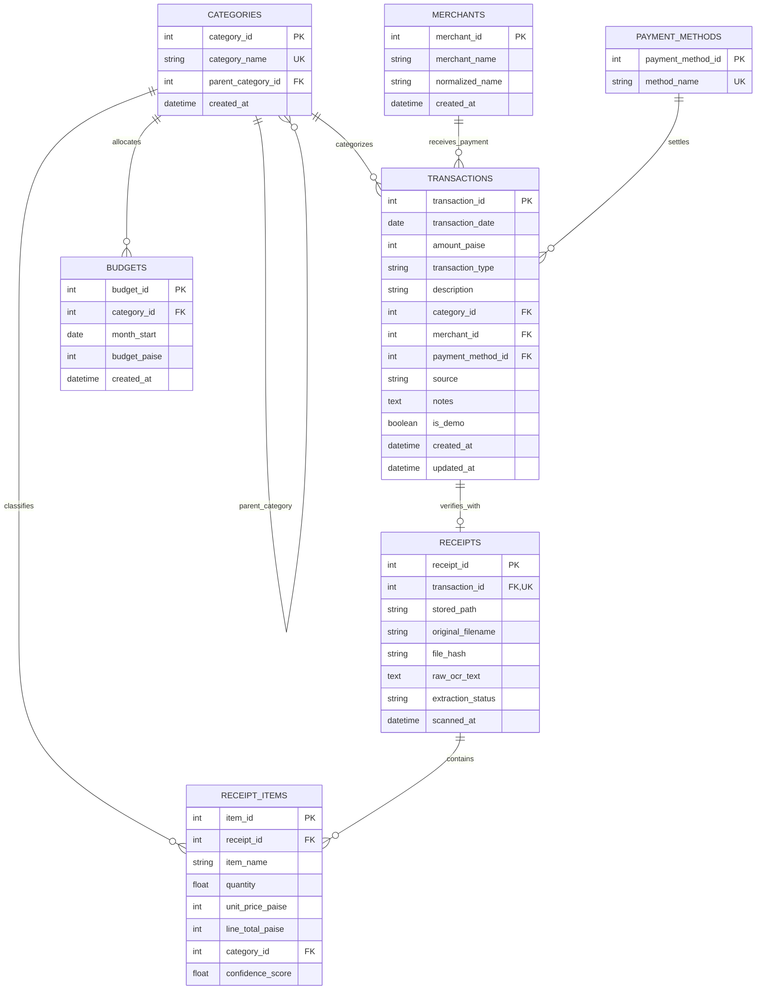

# SpendWise — Daily Expenditure Analyser
## Database Management Systems (DBMS) Project Documentation

**Project Title:** SpendWise — Daily Expenditure Analyser  
**Database Engine:** SQLite 3 (with Foreign Key Enforcement)  
**ORM:** SQLAlchemy 2.0  
**Backend Framework:** Python FastAPI  
**Frontend Framework:** React 19 + TypeScript + Tailwind CSS  
**Target Environment:** 100% Offline Local Laptop Application  

---

## 1. Problem Statement

Personal financial discipline requires regular, accurate expenditure tracking. However, individuals often struggle with:
1. **Friction of manual entry:** Recording daily expenses by hand is tedious, leading to abandoned tracking.
2. **Loss of receipts:** Paper and digital receipts are easily misplaced without itemized records.
3. **Privacy and security risks:** Most existing expense trackers upload sensitive personal transactions and receipts to third-party cloud servers.
4. **Lack of actionable insights:** Simple totals fail to highlight abnormal expenditure spikes, category shifts, or pacing against monthly limits.

**SpendWise** addresses these challenges through a privacy-preserving, local-first expenditure tracking architecture combining a normalized relational database, local optical character recognition (OCR), statistical anomaly detection, and natural language explanations.

---

## 2. Objectives

- **Local Relational Persistence:** Store all financial records, receipt items, categories, merchants, and budgets in an ACID-compliant local database.
- **Accurate Financial Representation:** Store currency in integer paise (1 Rupee = 100 Paise) to eliminate floating-point rounding errors.
- **Automated Receipt Ingestion:** Extract merchant, date, total, and item lines from uploaded images and PDFs locally using Tesseract and PyPDF.
- **Double-Counting Prevention:** Formulate database queries that strictly separate transaction-level aggregates from itemized receipt details.
- **Intelligent Financial Monitoring:** Detect unusual purchase patterns using scikit-learn Isolation Forest and explain verified SQL statistics in plain English.
- **Referential Integrity:** Enforce foreign key constraints, unique constraints, check constraints, and safe cascading actions.

---

## 3. System Architecture

```
┌─────────────────────────────────────────────────────────────┐
│                       Client Layer                          │
│     React 19 + TypeScript + Tailwind CSS + Recharts UI     │
│                   (Running on 127.0.0.1:5173)               │
└──────────────────────────────▲──────────────────────────────┘
                               │ HTTP / JSON API
┌──────────────────────────────▼──────────────────────────────┐
│                    Application / API Layer                  │
│       FastAPI + Pydantic v2 + SQLAlchemy ORM (Uvicorn)       │
│                   (Running on 127.0.0.1:8000)               │
├──────────────────────────────┬──────────────────────────────┤
│       Analytics Engine       │          OCR Engine          │
│   SQL Aggregation + scikit   │     pytesseract + pypdf      │
│   Isolation Forest Outliers  │    Local Regex Extraction    │
└──────────────────────────────┴──────────────────────────────┘
                               │ SQLite DB API
┌──────────────────────────────▼──────────────────────────────┐
│                      Database Layer                         │
│       SQLite 3 Database File (`data/spendwise.db`)           │
│     PRAGMA foreign_keys = ON | Integer Paise Precision      │
└─────────────────────────────────────────────────────────────┘
```

---

## 4. Entity-Relationship (ER) Diagram



---

## 5. Relational Schema and Integrity Constraints

### 5.1 Tables Definition

1. **`categories`**
   - `category_id`: INTEGER PRIMARY KEY AUTOINCREMENT
   - `category_name`: VARCHAR(100) NOT NULL UNIQUE
   - `parent_category_id`: INTEGER REFERENCES categories(category_id) ON DELETE SET NULL
   - `created_at`: DATETIME NOT NULL

2. **`merchants`**
   - `merchant_id`: INTEGER PRIMARY KEY AUTOINCREMENT
   - `merchant_name`: VARCHAR(150) NOT NULL
   - `normalized_name`: VARCHAR(150) NOT NULL (Indexed for matching)
   - `created_at`: DATETIME NOT NULL

3. **`payment_methods`**
   - `payment_method_id`: INTEGER PRIMARY KEY AUTOINCREMENT
   - `method_name`: VARCHAR(50) NOT NULL UNIQUE

4. **`transactions`**
   - `transaction_id`: INTEGER PRIMARY KEY AUTOINCREMENT
   - `transaction_date`: DATE NOT NULL (Indexed)
   - `amount_paise`: INTEGER NOT NULL (CHECK: `amount_paise > 0`)
   - `transaction_type`: VARCHAR(20) NOT NULL (CHECK: `transaction_type IN ('expense', 'income', 'refund')`)
   - `description`: VARCHAR(255)
   - `category_id`: INTEGER REFERENCES categories(category_id) ON DELETE SET NULL (Indexed)
   - `merchant_id`: INTEGER REFERENCES merchants(merchant_id) ON DELETE SET NULL (Indexed)
   - `payment_method_id`: INTEGER NOT NULL REFERENCES payment_methods(payment_method_id) ON DELETE RESTRICT
   - `source`: VARCHAR(20) NOT NULL (CHECK: `source IN ('manual', 'receipt')`)
   - `notes`: TEXT
   - `is_demo`: BOOLEAN NOT NULL DEFAULT 0 (Indexed)
   - `created_at`: DATETIME NOT NULL
   - `updated_at`: DATETIME NOT NULL

5. **`receipts`**
   - `receipt_id`: INTEGER PRIMARY KEY AUTOINCREMENT
   - `transaction_id`: INTEGER NOT NULL UNIQUE REFERENCES transactions(transaction_id) ON DELETE CASCADE
   - `stored_path`: VARCHAR(500) NOT NULL
   - `original_filename`: VARCHAR(255) NOT NULL
   - `file_hash`: VARCHAR(64) NOT NULL (SHA-256, Indexed for duplicate detection)
   - `raw_ocr_text`: TEXT
   - `extraction_status`: VARCHAR(30) NOT NULL
   - `scanned_at`: DATETIME NOT NULL

6. **`receipt_items`**
   - `item_id`: INTEGER PRIMARY KEY AUTOINCREMENT
   - `receipt_id`: INTEGER NOT NULL REFERENCES receipts(receipt_id) ON DELETE CASCADE (Indexed)
   - `item_name`: VARCHAR(255) NOT NULL
   - `quantity`: FLOAT NOT NULL DEFAULT 1.0
   - `unit_price_paise`: INTEGER
   - `line_total_paise`: INTEGER NOT NULL (CHECK: `line_total_paise >= 0`)
   - `category_id`: INTEGER REFERENCES categories(category_id) ON DELETE SET NULL
   - `confidence_score`: FLOAT

7. **`budgets`**
   - `budget_id`: INTEGER PRIMARY KEY AUTOINCREMENT
   - `category_id`: INTEGER NOT NULL REFERENCES categories(category_id) ON DELETE CASCADE
   - `month_start`: DATE NOT NULL (Indexed)
   - `budget_paise`: INTEGER NOT NULL (CHECK: `budget_paise > 0`)
   - `created_at`: DATETIME NOT NULL
   - **Constraint:** UNIQUE(`category_id`, `month_start`)

---

## 6. Normalization Analysis (Up to 3NF)

The SpendWise database schema was designed in compliance with the Third Normal Form (3NF):

### First Normal Form (1NF)
- **Atomic Values:** Every attribute contains atomic, indivisible values. For instance, `receipt_items` splits multi-item purchases into individual rows rather than storing comma-separated lists.
- **Unique Records:** Each relation contains a distinct primary key (`transaction_id`, `receipt_id`, `item_id`, etc.).
- **No Repeating Groups:** Recurring items belong to their own relation (`receipt_items`).

### Second Normal Form (2NF)
- A table is in 2NF if it is in 1NF and all non-key attributes are fully functionally dependent on the entire primary key.
- All tables employ surrogate integer primary keys (`transaction_id`, `category_id`, etc.). Since every primary key is single-column, no partial functional dependency on a composite key can exist.
- In `budgets`, although `(category_id, month_start)` forms a candidate key, the surrogate `budget_id` is the primary key and non-key attributes (`budget_paise`, `created_at`) depend on the key entirely.

### Third Normal Form (3NF)
- A table is in 3NF if it is in 2NF and has no transitive dependencies (non-key attributes depending on other non-key attributes).
- **Merchants Normalization:** Instead of storing raw merchant strings and addresses in `transactions`, merchants are separated into the `merchants` table.
- **Payment Methods Normalization:** Payment method types are isolated in `payment_methods` rather than stored redundantly across transaction rows.
- **Line Items Normalization:** Line item descriptions and item unit prices depend on `item_id` and belong in `receipt_items`, not in `transactions` or `receipts`.

---

## 7. Prevention of Double-Counting

A critical database architecture problem in expenditure systems is reconciling transaction totals with itemized receipt rows:

1. **The Issue:** A transaction of ₹500 may have an attached receipt with 2 items of ₹250 each. If a query naively sums both `transactions.amount_paise` and `receipt_items.line_total_paise`, total expenditure would be reported as ₹1000 instead of ₹500.
2. **Resolution in SpendWise:**
   - **Total Expenditure Calculation:** Always queries `transactions.amount_paise` strictly where `transaction_type = 'expense'`. Receipt items are never added to transaction aggregates.
   - **Category-Level Aggregation:**
     - For transactions without receipts, the transaction's `category_id` and `amount_paise` are used.
     - For transactions with receipts, transaction-level category totals are computed cleanly without joining receipt item rows into the outer sum.
   - **Reconciliation Check:** During receipt review, the application calculates `diff = |total_rupees - sum(items.line_total_rupees)|`. If `diff > 1.0`, an explicit reconciliation warning is displayed.

---

## 8. Essential SQL Queries

### 8.1 Monthly Expenditure & Transaction Count
```sql
SELECT 
    COALESCE(SUM(amount_paise), 0) AS total_expense_paise,
    COUNT(transaction_id) AS transaction_count
FROM transactions
WHERE transaction_date >= '2026-10-01'
  AND transaction_date <= '2026-10-31'
  AND transaction_type = 'expense';
```

### 8.2 Category Breakdown with Join
```sql
SELECT 
    c.category_id,
    COALESCE(c.category_name, 'Uncategorized') AS category_name,
    SUM(t.amount_paise) AS total_paise,
    COUNT(t.transaction_id) AS txn_count
FROM transactions t
LEFT JOIN categories c ON t.category_id = c.category_id
WHERE t.transaction_date >= '2026-10-01'
  AND t.transaction_date <= '2026-10-31'
  AND t.transaction_type = 'expense'
GROUP BY c.category_id, c.category_name
ORDER BY total_paise DESC;
```

### 8.3 Daily Expenditure Trend (Date-Based Grouping)
```sql
SELECT 
    transaction_date,
    SUM(amount_paise) AS daily_paise,
    COUNT(transaction_id) AS daily_count
FROM transactions
WHERE transaction_date >= '2026-10-01'
  AND transaction_date <= '2026-10-31'
  AND transaction_type = 'expense'
GROUP BY transaction_date
ORDER BY transaction_date ASC;
```

### 8.4 Category-Wise Month-over-Month Comparison
```sql
WITH current_month AS (
    SELECT category_id, SUM(amount_paise) AS cur_paise
    FROM transactions
    WHERE transaction_date BETWEEN '2026-10-01' AND '2026-10-31'
      AND transaction_type = 'expense'
    GROUP BY category_id
),
prev_month AS (
    SELECT category_id, SUM(amount_paise) AS prev_paise
    FROM transactions
    WHERE transaction_date BETWEEN '2026-09-01' AND '2026-09-30'
      AND transaction_type = 'expense'
    GROUP BY category_id
)
SELECT 
    c.category_name,
    COALESCE(cm.cur_paise, 0) AS current_paise,
    COALESCE(pm.prev_paise, 0) AS prev_paise,
    COALESCE(cm.cur_paise, 0) - COALESCE(pm.prev_paise, 0) AS diff_paise
FROM categories c
LEFT JOIN current_month cm ON c.category_id = cm.category_id
LEFT JOIN prev_month pm ON c.category_id = pm.category_id
WHERE cm.cur_paise > 0 OR pm.prev_paise > 0;
```

### 8.5 Budget Tracking and Utilization
```sql
SELECT 
    b.budget_id,
    c.category_name,
    b.budget_paise,
    COALESCE(SUM(t.amount_paise), 0) AS spent_paise,
    b.budget_paise - COALESCE(SUM(t.amount_paise), 0) AS remaining_paise,
    ROUND((COALESCE(SUM(t.amount_paise), 0) * 100.0) / b.budget_paise, 1) AS pct_used
FROM budgets b
JOIN categories c ON b.category_id = c.category_id
LEFT JOIN transactions t ON t.category_id = b.category_id 
    AND t.transaction_date >= b.month_start 
    AND t.transaction_date < DATE(b.month_start, '+1 month')
    AND t.transaction_type = 'expense'
WHERE b.month_start = '2026-10-01'
GROUP BY b.budget_id, c.category_name, b.budget_paise;
```

---

## 9. Transaction Integrity & Concurrency

1. **Foreign Key Enforcement:** SQLite defaults to disabling foreign keys. On every connection, SpendWise executes `PRAGMA foreign_keys = ON;`.
2. **Atomic Ingestion:** Saving a scanned receipt executes inside a single database transaction block:
   ```python
   # db_txn, db_receipt, and db_items all commit together or rollback together
   db.add(db_txn)
   db.flush()
   db.add(db_receipt)
   db.flush()
   for item in items:
       db.add(item)
   db.commit()
   ```
3. **Cascade Rules:** Deleting a transaction cascades to delete its linked receipt and receipt items. Deleting a category with active transactions is blocked unless reassignment is supplied.

---

## 10. Limitations and Future Scope

- **Current Limitations:**
  - Optical character recognition is dependent on receipt print quality and lighting conditions.
  - Multi-user authentication is omitted in accordance with the single-user local laptop privacy requirement.
- **Future Enhancements:**
  - Support recurring transaction auto-detection using time-series periodicity.
  - Support multi-currency conversion with offline historical FX rates.
  - Add native desktop packaging via Electron or Tauri.
